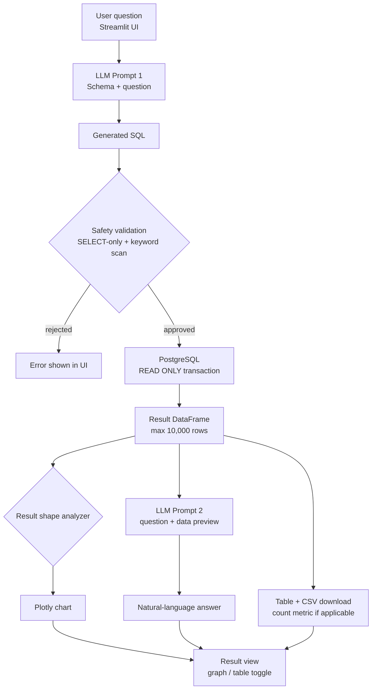

<div align="center">

# Ask Your Data

**A natural-language SQL chatbot for PostgreSQL**

*Ask a question in plain English — get a validated read-only query, live results,
an auto-selected chart, and a written answer.*

<br/>

[](https://www.python.org/)
[](https://streamlit.io/)
[](https://www.postgresql.org/)
[](https://groq.com)
[](#license)

<br/>

[Overview](#overview) · [Features](#key-features) · [Quick Start](#quick-start) · [Architecture](#architecture) · [Usage](#using-the-app) · [Docker](#docker-deployment)

</div>

---

> **At a glance:** `Question → SQL → Validate → Execute → Visualize → Answer`
> The entire pipeline runs in seconds, always inside a read-only transaction.

## Table of Contents

**Understanding the project**
1. [Overview](#overview)
2. [Key Features](#key-features)
3. [Architecture](#architecture)
4. [How It Works](#how-it-works)
5. [Tech Stack](#tech-stack)
6. [Project Structure](#project-structure)

**Getting it running**
7. [Quick Start](#quick-start)
8. [Getting Started](#getting-started)
   - [Prerequisites](#prerequisites)
   - [Installation](#installation)
   - [Configuration](#configuration)
   - [Running the Application](#running-the-application)
9. [Using the App](#using-the-app)

**Reference**
10. [Database Setup](#database-setup)
11. [Docker Deployment](#docker-deployment)
12. [Safety Guardrails](#safety-guardrails)
13. [Troubleshooting](#troubleshooting)

---

## Overview

Ask Your Data lets non-technical users query a PostgreSQL database without writing SQL.
A question such as *"Which department has the highest average salary?"* is converted into
SQL by an LLM, validated against a read-only safety policy, executed against the database,
and rendered as an interactive result view with an auto-selected chart and a short written
answer.

The application ships with a dark, red-accented theme, a query history sidebar, one-click
example questions, CSV export, and a collapsible panel showing the generated SQL for
transparency.

---

## Key Features

### Querying

| Feature | Description |
| --- | --- |
| Natural-language querying | Ask questions in plain English; the LLM generates PostgreSQL SQL |
| Count highlights | Questions starting with "How many..." surface an explicit metric card |
| Schema discovery | Tables and columns are inspected at runtime — no hardcoding |

### Presentation

| Feature | Description |
| --- | --- |
| Auto-visualization | Chooses line, bar, scatter, or histogram charts based on result shape |
| Natural-language answers | A second LLM call summarizes the result set in plain language |
| Result views | Toggle between "With graph" and "Results only" |
| CSV export | Download any result set as `query-results.csv` |
| Example questions | Built-in suggestions to help new users get started |

### Reliability & Security

| Feature | Description |
| --- | --- |
| Read-only safety layer | Multi-stage validation blocks anything that is not a single `SELECT` |
| Large-result handling | Results capped at 10,000 rows with a 30-second statement timeout |
| Database health check | Live connected/unavailable badge with a 15-second refresh |
| Query history | Last 20 questions kept; the 8 most recent are one-click in the sidebar |

---

## Quick Start

```powershell
# 1. Install dependencies
python -m venv .venv
.venv\Scripts\activate
pip install -r requirements.txt

# 2. Configure  (edit the values inside)
copy .env.example .env

# 3. Launch
.venv\Scripts\streamlit run app.py
```

Then open **http://localhost:8501** and ask your first question.

> **Note:** Full setup instructions, including the `.env` reference table and Docker
> options, are in [Getting Started](#getting-started).

---

## Architecture



**Legend:** rounded boxes are processing steps · diamonds are decision points ·
arrows labelled *rejected* / *approved* show the safety gate.

---

## How It Works

### The pipeline at a glance

| # | Stage | Function | Input → Output |
| --- | --- | --- | --- |
| 1 | Schema collection | `agent.get_schema()` | Database → table/column list |
| 2 | SQL generation | `agent.generate_sql()` | Question + schema → SQL string |
| 3 | Safety validation | `is_select_query()` / `is_safe_sql()` | SQL → pass / reject |
| 4 | Execution | `agent.execute_sql()` | SQL → pandas `DataFrame` |
| 5 | Answer generation | `agent.generate_answer()` | Question + rows → text summary |
| 6 | Visualization | `visualization.create_chart()` | DataFrame → Plotly figure |
| 7 | Presentation | `app.py` | All of the above → result view |

### Stage details

**1 — Schema collection**
`agent.get_schema()` inspects the live database through SQLAlchemy and lists every table
with its column names and data types.

**2 — SQL generation**
`agent.generate_sql()` sends the schema plus the user's question to **Groq's
`openai/gpt-oss-120b`** model with temperature `0`, requesting a single read-only
PostgreSQL query. Markdown code fences are stripped from the response.

**3 — Safety validation**
The query passes through two independent checks before anything touches the database:

- `is_select_query()` — tokenizes the SQL (removing comments and string literals) and
  verifies the first token is `SELECT` or `WITH`.
- `is_safe_sql()` — rejects multiple statements and any occurrence of `INSERT`, `UPDATE`,
  `DELETE`, `DROP`, `ALTER`, `TRUNCATE`, `CREATE`, `GRANT`, `COPY`, `INTO`, and similar
  keywords.

**4 — Execution**
`agent.execute_sql()` runs the query inside a **`READ ONLY` transaction** with
`statement_timeout = 30s`, fetches up to 10,001 rows to detect truncation, and returns a
pandas `DataFrame` flagged with `df.attrs["truncated"]`.

**5 — Answer generation**
`agent.generate_answer()` passes the question plus the first 100 rows back to the LLM for
a concise summary. If the LLM is unavailable, the raw results are still displayed.

**6 — Visualization**
`visualization.create_chart()` inspects column types and names to pick the most
appropriate chart:

| Result shape | Chart |
| --- | --- |
| Date/dimension + numeric value | Line chart with markers |
| Category + numeric value | Bar chart sorted by value (top 30 categories) |
| Two numeric columns (many rows) | Scatter plot |
| One row, multiple numeric values | Bar chart of measures |
| Single numeric column | Distribution histogram |
| Text-only columns | Value-count bar chart |

**7 — Presentation**
The UI renders a count metric (when the question asks "how many"), the written answer,
the result table, the chart, a CSV download button, and the generated SQL in a collapsible
expander.

---

## Tech Stack

| Layer | Technology |
| --- | --- |
| UI framework | Streamlit 1.64 |
| LLM provider | Groq (`openai/gpt-oss-120b`) via `langchain-groq` |
| Database | PostgreSQL (tested on PostgreSQL 18) |
| ORM / driver | SQLAlchemy 2.1 + psycopg2-binary |
| Data handling | pandas 3.0 |
| Charting | Plotly 7.1 |
| Configuration | python-dotenv (`.env` file) |
| Containerization | Docker (Python 3.13-slim image) |

---

## Project Structure

```
SQL_Chatbot/
├── app.py               # Streamlit UI: layout, session state, result rendering
├── agent.py             # LLM prompts, SQL generation, safety checks, execution
├── database.py          # Engine creation, env validation, health settings
├── visualization.py     # Automatic chart selection (Plotly)
├── schema.py            # CLI utility: prints database schema
├── app.css              # Custom styling (retinted to the red theme)
├── requirements.txt     # Pinned dependencies
├── .streamlit/
│   └── config.toml      # Dark theme + red accent configuration
├── .env                 # Secrets (not committed — see .gitignore)
├── .env.example         # Configuration template
├── Dockerfile           # Container build recipe
├── .dockerignore        # Keeps .venv and .env out of images
└── .gitignore
```

### Module responsibilities

| Module | Exports | Role |
| --- | --- | --- |
| `app.py` | — | Page layout, form handling, result display, CSS loading |
| `agent.py` | `generate_sql`, `execute_sql`, `generate_answer`, `is_select_query`, `is_safe_sql` | Full question-to-answer pipeline |
| `database.py` | `get_engine`, `missing_database_settings` | Lazy, cached SQLAlchemy engine |
| `visualization.py` | `create_chart` | Result-aware chart builder |
| `schema.py` | `print_schema` | Standalone schema inspector (`python schema.py`) |

---

## Getting Started

### Prerequisites

- **Python 3.13** (recommended; 3.11+ should work)
- **PostgreSQL** running locally or on a reachable host
- A free **Groq API key** — https://console.groq.com

### Installation

```powershell
# 1. Clone or download the project
cd SQL_Chatbot

# 2. Create a virtual environment
python -m venv .venv

# 3. Activate it
.venv\Scripts\activate          # Windows
# source .venv/bin/activate     # macOS / Linux

# 4. Install pinned dependencies
pip install -r requirements.txt
```

### Configuration

Create a `.env` file in the project root (a template is provided):

```dotenv
GROQ_API_KEY=your_groq_api_key_here
DB_USER=postgres
DB_PASSWORD=your_password_here
DB_HOST=localhost
DB_PORT=5432
DB_NAME=ai_data_assistant
```

| Variable | Purpose |
| --- | --- |
| `GROQ_API_KEY` | Authenticates LLM requests (required for SQL generation and answers) |
| `DB_USER` / `DB_PASSWORD` | PostgreSQL credentials |
| `DB_HOST` | `localhost` for local runs; `host.docker.internal` inside Docker |
| `DB_PORT` | PostgreSQL port (default `5432`) |
| `DB_NAME` | Target database name |

> **Important:** Use `localhost` when running the app directly on your machine.
> `host.docker.internal` only resolves *inside* a Docker container — using it locally
> is the most common reason the sidebar shows **Unavailable**.

The sidebar shows an **Unavailable** badge with the exact missing or failing setting if
anything is misconfigured, and the Ask button stays disabled until the connection succeeds.

### Running the Application

```powershell
.venv\Scripts\streamlit run app.py
```

The app opens automatically at **http://localhost:8501**.

Verify the installation independently of the UI:

```powershell
python schema.py    # Prints all tables and columns
```

---

## Using the App

### Workflow

1. Confirm the sidebar shows a green **Connected** badge.
2. Choose a result view: **With graph** or **Results only**.
3. Type a question or click one of the example suggestions.
4. Press **Ask question** and wait for the spinner to finish.

### Example questions

```
Show all employees
Which department has the highest average salary?
How many employees are in the IT department?
Show employees who joined after 2023
Count records in each department
```

### Reading the result

| Panel | What it shows |
| --- | --- |
| **Count metric** | Displayed automatically for "how many" questions |
| **Your result** | The LLM's plain-language answer |
| **Matching data** | Full result table with row/column counts |
| **Download CSV** | Exports the visible result set |
| **Chart** | Shown when the "With graph" view is active |
| **View generated SQL** | Expand to inspect the exact query that ran |

---

## Database Setup

The app works with any PostgreSQL schema — new tables and columns need no code changes.

<details>
<summary><b>Click to expand the demo dataset SQL</b> (8 rows · table: <code>employees</code>)</summary>

```sql
CREATE DATABASE ai_data_assistant;

\c ai_data_assistant

CREATE TABLE employees (
    employee_id   INTEGER PRIMARY KEY,
    name          VARCHAR(100) NOT NULL,
    department    VARCHAR(100) NOT NULL,
    salary        NUMERIC(10, 2) NOT NULL,
    joining_date  DATE NOT NULL
);

INSERT INTO employees (employee_id, name, department, salary, joining_date) VALUES
    (1, 'Rahul',  'IT',      65000.00, '2024-01-15'),
    (2, 'Aman',   'IT',      72000.00, '2023-06-10'),
    (3, 'Priya',  'HR',      55000.00, '2024-03-20'),
    (4, 'Neha',   'Finance', 68000.00, '2022-11-05'),
    (5, 'Rohit',  'Sales',   58000.00, '2023-08-18'),
    (6, 'Ankit',  'IT',      80000.00, '2022-05-12'),
    (7, 'Pooja',  'HR',      60000.00, '2023-02-25'),
    (8, 'Karan',  'Sales',   62000.00, '2024-04-10');
```

</details>

---

## Docker Deployment

The image excludes local state and secrets via `.dockerignore` (`.venv`, `.env`,
`__pycache__`).

```powershell
# Build
docker build -t sql-chatbot .

# Run — pass secrets at runtime
docker run -d -p 8501:8501 `
  -e GROQ_API_KEY=gsk_xxx `
  -e DB_USER=postgres `
  -e DB_PASSWORD=xxx `
  -e DB_NAME=ai_data_assistant `
  --add-host=host.docker.internal:host-gateway `
  sql-chatbot
```

> **Note:** The Dockerfile sets `DB_HOST=host.docker.internal` by default so the
> container reaches the database on the host machine. Never bake `.env` into an image —
> always pass secrets with `-e`.

---

## Safety Guardrails

Defense is layered — no single point of failure:

| Layer | Mechanism |
| --- | --- |
| Prompt | LLM instructed to emit only `SELECT` / `WITH ... SELECT` |
| Token scan | Comments and string literals stripped before keyword analysis |
| Statement count | More than one statement (or a misplaced `;`) is rejected |
| Keyword blocklist | DDL/DML/admin commands rejected, including `SELECT ... INTO` |
| Transaction mode | `SET TRANSACTION READ ONLY` at the session level |
| Time budget | `statement_timeout = 30000ms` stops runaway queries |
| Row cap | First 10,000 rows fetched; UI indicates truncation |
| Network | 5-second connection timeout prevents UI hangs |

---

## Troubleshooting

| Symptom | Cause | Fix |
| --- | --- | --- |
| Sidebar shows **Unavailable** | Wrong `DB_HOST`/credentials | Use `localhost` for local runs; check password |
| Ask button disabled | Database health check failed | Read the error caption under the badge in the sidebar |
| `Missing GROQ_API_KEY` | `.env` lacks the key | Add `GROQ_API_KEY` and restart the app |
| "did not pass the read-only safety check" | LLM produced a non-SELECT query | Rephrase the question more precisely |
| Empty result, no error | Question matches no rows | Check column/table names via `python schema.py` |
| Chart caption says no suitable chart | Result shape unsupported | Switch to **Results only** or narrow the question |
| Port already in use | 8501 occupied | `streamlit run app.py --server.port 8502` |
| LLM answers fail, table still shows | Groq outage or quota | The result table and SQL are still shown — retry the question later for a written summary |

---

## License

This project is provided as-is for educational and internal use.

<div align="center">
<small>Ask Your Data · Streamlit + Groq + PostgreSQL</small>
</div>
